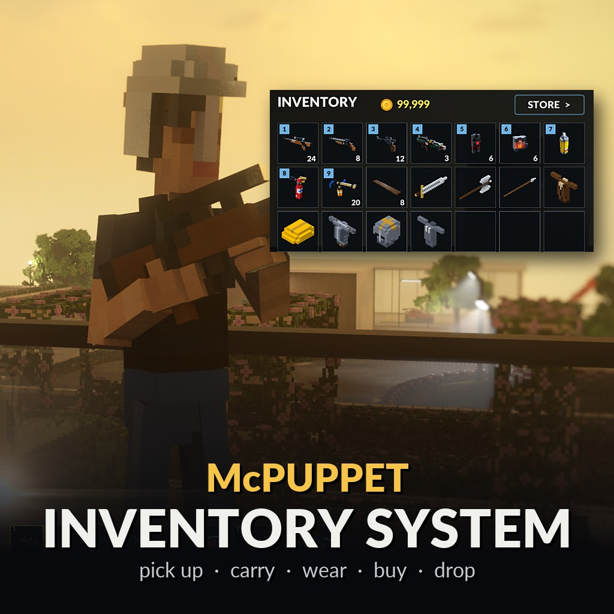

# McPuppet Inventory System (Alpha)

On the Steam Workshop: [McPuppet Inventory System (Alpha)](https://steamcommunity.com/sharedfiles/filedetails/?id=3840357667)

**ALPHA:** this mod is early and in active development. It may change drastically from one update to the next, and things may break. Tell me what you find!

**A real inventory for Teardown, on any map, in single player and multiplayer.** You start with nothing. Pick things up, carry them in a grid, put tools on hotkeys, wear clothing and armour, buy and sell in the store with gold coins, and drop anything back into the world. Die, and everything you carried lies where you fell.

## How to play
- Enable it under Global mods, then play any map.
- **I** opens the inventory. Drag items around the grid; drag one out of the window to drop it.
- **E** picks up the item you look at.
- **1 - 9** are your hotkeys. Drag a tool onto a hotkey slot, or press a number over an item. Only the tools on your hotkeys are in the game's tool wheel.
- **Right-click** an item to wear it or give it a hotkey.
- With nothing in your hands, attack **punches**.
- Controller: Map opens the inventory, A takes and places, X wears or drops, B closes (not yet tried with a real pad, tell me how it goes).

## Every item is a real object
- Weapons and tools lie in the world, get picked up, dropped and picked up again, by anyone.
- **Ammo is counted:** a gun keeps its rounds when you drop it, bombs and planks get used up. No more infinite pipe bombs, even on sandbox maps.
- When you die you drop everything where you fell. Go back for it, or someone else will.

## The store and gold coins
- Open the store column with the STORE button in the inventory. Click an item to buy it; drag one of yours onto the store to sell it.
- Every tool of the game is for sale, and so are the items of packs and other mods.
- Your gold shows in the bottom right corner. Everyone starts with 500 gold; sell what you find for more.

## Clothing and weapons packs
The inventory has four equipment slots: head, upper body, lower body and feet. Clothes fit every character of the game, and each piece has defense, mobility and noise. The clothes and melee weapons come in packs:
- [**McPuppet Basic Clothing Pack Vol 1**](https://steamcommunity.com/sharedfiles/filedetails/?id=3840291332): 27 pieces, from T-shirts and hoodies to full plate armour and hero costumes.
- [**McPuppet Basic Weapons Pack Vol 1**](https://steamcommunity.com/sharedfiles/filedetails/?id=3840291496): swords, axes, hammers, a spear and more.

Without packs you still have the game's own tools, the store and everything else.

## Multiplayer
The host enables it; everyone downloads it when joining. The host keeps every inventory and every item in the world, so players can't cheat items into their pockets. Everyone sees what everyone wears and holds.

## For modders
Other mods can add items, clothing and weapons, hand items out, read what players carry, pay gold, read item colours and hear melee hits, all through the registry. The guides: [MODDING.md](MODDING.md) (items, the registry API, gold, colours, melee hits), [MODDING_CLOTHING.md](MODDING_CLOTHING.md), [MODDING_WEAPONS.md](MODDING_WEAPONS.md), and an [example pack](example%20pack) to copy.

## Community

Join the [Discord community](https://discord.gg/gNpRewdkxf) to post bug reports and suggestions.

## Install

Subscribe on the [Steam Workshop](https://steamcommunity.com/sharedfiles/filedetails/?id=3840357667), or clone this repository into
`Documents/Teardown/mods/inventory`. Enable it under **Global mods** (in multiplayer the host does).

## Credits

Made by AgeOfAlgorithms and Claude (Anthropic). MIT licence.
